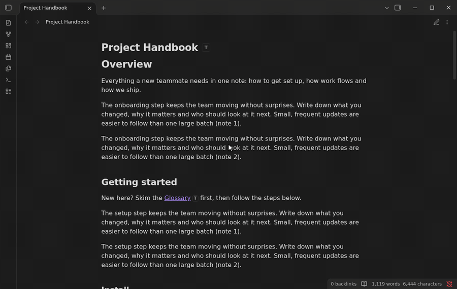

# Hovered Table of Content — Obsidian table of contents plugin



[](https://github.com/itsNikolay/obsidian-hovered-table-of-content/releases/latest)
[](https://github.com/itsNikolay/obsidian-hovered-table-of-content/actions/workflows/ci.yml)
[](LICENSE)

An **Obsidian plugin** that keeps a note's **table of contents (TOC)** one hover away. Hover a small **T** icon to see the note's outline, **preview any section** without scrolling, peek into the outline of **linked notes**, and keep **sticky headings** pinned at the top while you read long Markdown notes.

[](https://community.obsidian.md/plugins/hovered-table-of-content)

The button opens the official plugin installation page. Choose **Add to Obsidian**, then **Install** and **Enable** in the app.

**Hovered Table of Content** is the plugin name. "Obsidian" describes the platform it extends; this is an independent project and is not affiliated with or endorsed by Obsidian.

## Table of contents in Obsidian without a sidebar

Obsidian's core Outline view lives in a sidebar and only shows the active note. Hovered Table of Content puts a **floating table of contents** inside every note, page preview and link, so you can navigate long notes, documentation, meeting notes and Zettelkasten links without opening panels or inserting a TOC block into your Markdown. It never edits your notes.

## Features

- **T icon.** Every note gets a small square **T** button right after its title. Hover over it to see the note's table of contents in a popup. When a table of contents or a preview is too long to fit, its bottom fades out until you scroll to the end.
- **Section previews.** Hover over a heading in the table of contents to preview that section: the heading, its text and its subsections. The heading stays highlighted while its preview is open, so you can see which section you are reading. Click the heading to jump to it (Ctrl/Cmd-click opens it in a new tab).
- **Previews of linked notes.** Hover over a link inside a preview to see the linked note in Obsidian's page preview. Every link to another note also gets its own **T** icon. Hover over it to see the linked note's table of contents, which previews its sections in turn.
- **T on links in notes.** Every link to another note in the note itself gets a **T** right after it, in Reading view and Live Preview. Hover over it to see the linked note's table of contents.
- **T in page previews.** Obsidian's page previews of notes get a **T** button too, with the table of contents of the previewed note.
- **Sticky headings.** When you scroll past a heading, it stays pinned at the top of the note. Click it to jump back. Each sticky heading has a **T** icon that lists only that heading's subheadings.
- **Heading numbers.** Headings in the table of contents are numbered, either within their section (`1.`, `2.`) or together with the numbers of their parents (`1.1.`, `1.2.`). Sticky headings can be numbered too. Your notes stay unchanged.

It works in Reading view, Live Preview and Source mode, with light and dark themes.

## Installation

### From the community directory

[](https://community.obsidian.md/plugins/hovered-table-of-content)

Open the [Hovered Table of Content listing](https://community.obsidian.md/plugins/hovered-table-of-content) and choose **Add to Obsidian**, then install and enable the plugin. If your app does not find the newly published listing yet, use BRAT or the manual installation below.

### With BRAT

1. Install and enable [BRAT](https://github.com/TfTHacker/obsidian42-brat) from Community plugins.
2. Run **BRAT: Add a beta plugin for testing** and enter `itsNikolay/obsidian-hovered-table-of-content`.
3. Enable **Hovered Table of Content** in **Settings → Community plugins**.

### Manually

1. Download `main.js`, `manifest.json` and `styles.css` from the [latest release](https://github.com/itsNikolay/obsidian-hovered-table-of-content/releases/latest).
2. Copy them to `<your vault>/.obsidian/plugins/hovered-table-of-content/`.
3. Reload Obsidian and enable **Hovered Table of Content** in **Settings → Community plugins**.

Requires Obsidian 1.5.7 or later.

## Settings

| Setting | Default | |
| --- | --- | --- |
| Icon after the note title | On | Shows the **T** right after the inline title of the note; it scrolls with the title. When Obsidian hides the inline title (**Settings → Appearance → Show inline title**), the **T** sits at the icon position. |
| Icon position | Top right | Where the **T** sits when it is not after the note title: top left, top center, top right, bottom left, bottom center or bottom right of the note. The popup opens towards the middle of the note. |
| Icon in notes | On | Shows the **T** button in each note. |
| Icons on links | On | Shows a **T** next to links in previews and in Obsidian's page previews of notes. |
| Icons on links in notes | On | Shows a **T** next to links to other notes in the note itself, in Reading view and Live Preview. |
| Heading numbers in tables of contents | On | Numbers the headings in tables of contents. |
| Heading number format | Within the section | *Within the section* numbers each heading among its siblings: `1.`, `2.`. *With the parents* adds the numbers of its parent headings: `1.1.`, `1.2.`. |
| Sticky headings | On | Turns sticky headings on or off. |
| Sticky heading mode | Heading with its parents | *Closest heading* shows only the last heading above the screen. *Heading with its parents* also shows its parent headings. |
| Icons on sticky headings | On | Shows a **T** with the subheadings next to each sticky heading. |
| Numbers on sticky headings | Off | Numbers the sticky headings in the heading number format. |

## Release security checks

Every release is built by GitHub Actions from a tagged commit. Before publishing, the workflow runs the unit and end-to-end tests, scans `main.js`, `manifest.json` and `styles.css` with VirusTotal and blocks the release on any detection, and attests build provenance for the three files. The scan report with SHA-256 hashes is included in the release notes.

## Development

The tests run in Docker, including end-to-end checks against the real Linux Obsidian app on a virtual display:

```sh
npm run docker:test    # lint, typecheck, unit tests (vitest + jsdom), build
npm run docker:check   # all of the above + end-to-end tests in real Obsidian
npm run docker:e2e     # only the end-to-end tests in real Obsidian
npm run docker:demo    # re-record docs/demo.gif in real Obsidian
```

The end-to-end run uses a synthetic vault created inside the container (`--network=none`). Screenshots and `report.json` are written to `artifacts/docker/`.

Without Docker, use Node 22.13 or later: `npm ci && npm run check`.

| Path | |
| --- | --- |
| `src/headings.ts` | Pure heading logic: nesting, sections, sticky headings |
| `src/links.ts` | Pure link logic: finds links in the editor's syntax tokens |
| `src/ui/popup.ts` | Hover popups that can be nested |
| `src/ui/toc.ts` | Table of contents popup, section previews, link icons |
| `src/ui/sticky.ts` | Sticky headings overlay |
| `src/view-decoration.ts` | Adds the button, sticky headings and link icons to a note view |
| `src/main.ts` | Plugin lifecycle and the link to the Obsidian API |
| `scripts/test-obsidian-docker.mts` | End-to-end tests against real Obsidian |
| `scripts/record-demo.mts` | Records the demo GIF at the top of this README |
| `scripts/scan-virustotal.mts` | VirusTotal scan of the release files |

## Releasing

Bump the version with `npm version <patch|minor|major>` (updates `manifest.json` and `versions.json`), then push the commit and its tag: `git push --follow-tags`. The tag must equal the manifest version (for example `1.0.1`, without a `v`). The release workflow needs the `VIRUSTOTAL_API_KEY` repository secret.

## Credits

Based on [obsidian-sample-plugin](https://github.com/obsidianmd/obsidian-sample-plugin). The sticky-heading approach comes from [obsidian-sticky-heading](https://github.com/imshenshen/obsidian-sticky-heading), and the heading handling from [obsidian-automatic-table-of-contents](https://github.com/johansatge/obsidian-automatic-table-of-contents).
